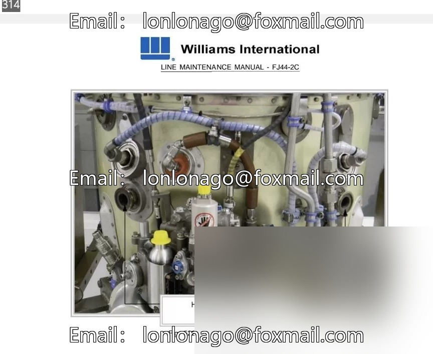
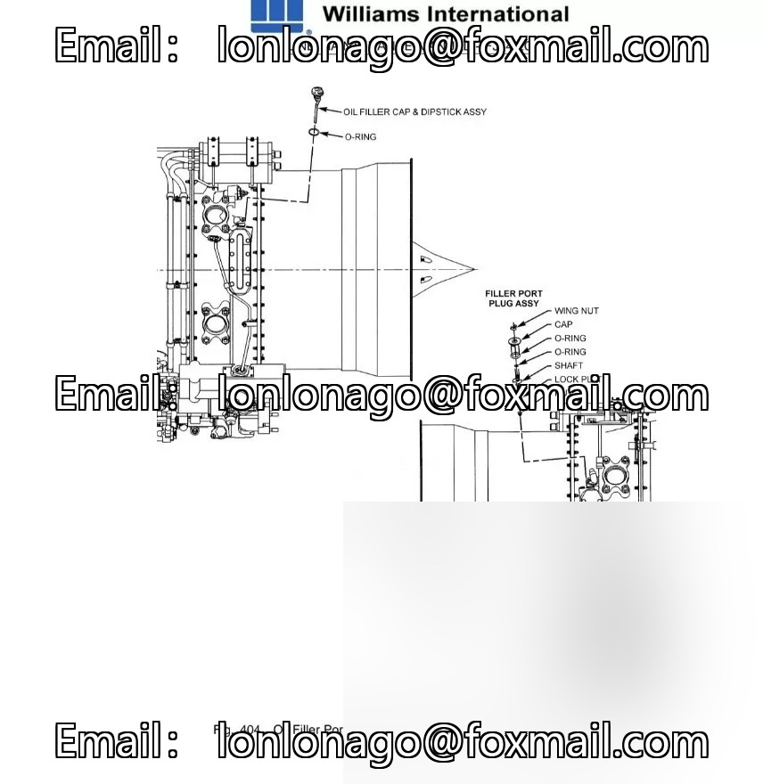
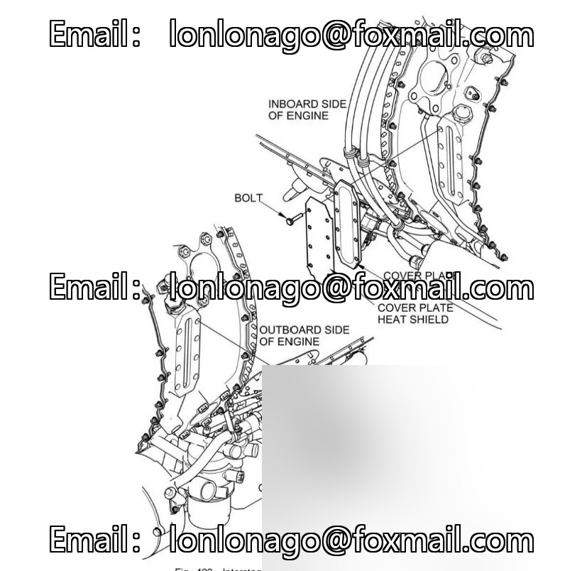

# Williams FJ44-2C Maintenance Manual

## Body

Williams FJ44-2C Maintenance Manual
Williams International FJ44-2C Engine Flight Maintenance Manual
PDF , 1000 pages, complete and clear content.
Applicable to Williams FJ44-2C aero turbofan engine, covering technical details such as maintenance, inspection, lubrication, and cooling, with extensive diagrams for disassembly, lubrication, cooling systems, etc. Suitable for frontline maintenance personnel, aviation maintenance engineers, and school teaching reference.
non-refundable upon sale.

92844

The manual covers maintenance, inspection, lubrication and cooling of the Williams FJ44-2C engine, with diagrams of disassembly, lubrication and cooling systems, intended for maintenance personnel and academic reference.

<!-- AI_ENRICHED -->

## Images

## Payment

Here is a pay link on Stripe ( https://buy.stripe.com/3cs8yP7sY87d0vu9AB ). Please contact me lonlonago@foxmail.com after funding $89, and I will send you a complete data files , thank you!

